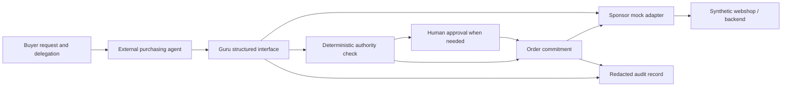

# Proposed architecture

**Planning document for sponsor integration. The local synthetic POC is separate and does not implement or verify a sponsor endpoint or field below.**

## Flow and boundaries

The buyer supplies intent and delegated authority. The agent proposes actions. Server-side policy and the commitment layer enforce authority; a model response is never itself an approval. The mock adapter holds credentials and exposes only documented sponsor functionality.

## Proposed contracts

Use OpenAPI 3.1 and JSON Schema for our own interface, subject to implementation confirmation. Keep these concepts separate:

| Concept | Required information |
|---|---|
| Purchase request | Buyer reference, quantity/unit, hard product requirements, delivery deadline/time zone, budget and allowed substitutions |
| Offer snapshot | Product identity, pack conversion, fixed price/currency/tax basis, available quantity, delivery evidence, timestamp and validity |
| Delegation | Authenticated buyer/agent, permitted operations, spend scope and approval conditions |
| Policy decision | Allowed, approval required, or blocked; machine-readable reasons and policy version |
| Approval | Authenticated approver, exact preview/version approved, decision and expiry |
| Order result | Correlation/idempotency key, mock order reference, confirmed or uncertain outcome |

These are team design proposals, not sponsor field names. Unknown tax, units or delivery semantics block commitment until resolved; they are not defaulted silently.

## Commitment and exceptions

Proposed states: `requested → offers_received → previewed → policy_checked → approval_pending/authorised → submitting → confirmed`. A blocked request, expiry, rejection, or an unknown submission outcome is recorded explicitly.

Before submission, recheck price, stock, deadline and authority. Bind approval to the exact order preview; material changes invalidate it. Define spend against the confirmed total including applicable charges and taxes. Allergen/dietary hard constraints are never bypassed by a generic budget approval.

Use idempotency across repeated submissions. If the sponsor mock lacks native support, document the limits of our local deduplication rather than claiming distributed exactly-once ordering. A timeout after submission becomes an unknown outcome: reconcile by reference before retrying and do not report an order as confirmed without evidence.

For partial availability, return the shortage and ranked feasible choices. Split orders or substitutions must be within explicitly delegated policy or approved as a new preview. No autonomous weakening of hard requirements.

## Trust, data and evaluation

Authenticate the agent and human separately; an `approved=true` value supplied by the agent is insufficient. Scope lookup and order operations to the buyer account. Keep keys server-side and out of logs. Treat product descriptions as untrusted data, not agent instructions.

Record request IDs, offer references, policy version, approval events, order state and concise reasons. Redact tokens, customer identifiers and sensitive terms. Publish only synthetic/redacted examples with confirmed redistribution permission.

Planned contract tests cover valid units, pack rounding, stale offers, budget boundaries, failed authentication, approval reuse, hard constraints, duplicate submissions, partial stock and uncertain outcomes. Integration claims must distinguish a local fixture from an authenticated sponsor mock call.

## Technology decisions still open

The local prototype uses Python's standard library only; this does not settle the production runtime/framework. Storage, agent framework, approval identity and deployment target are not selected. Verify the sponsor interface before choosing the adapter. An LLM may interpret requests or explain choices; it must not enforce financial authority.
